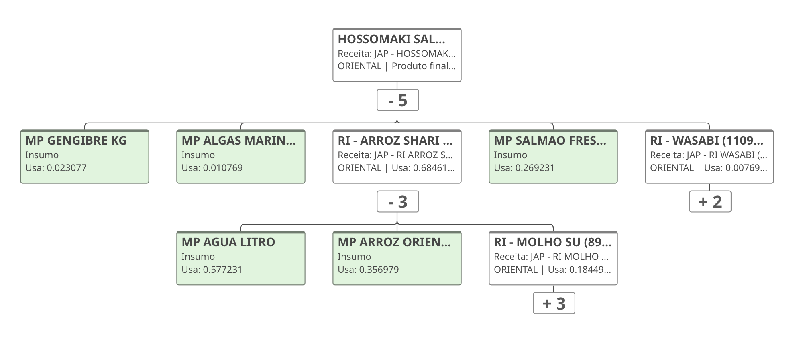
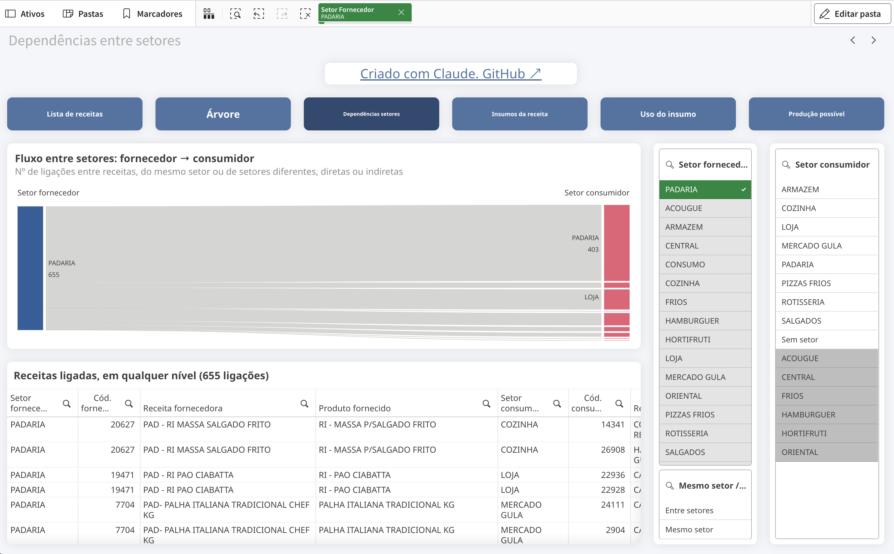
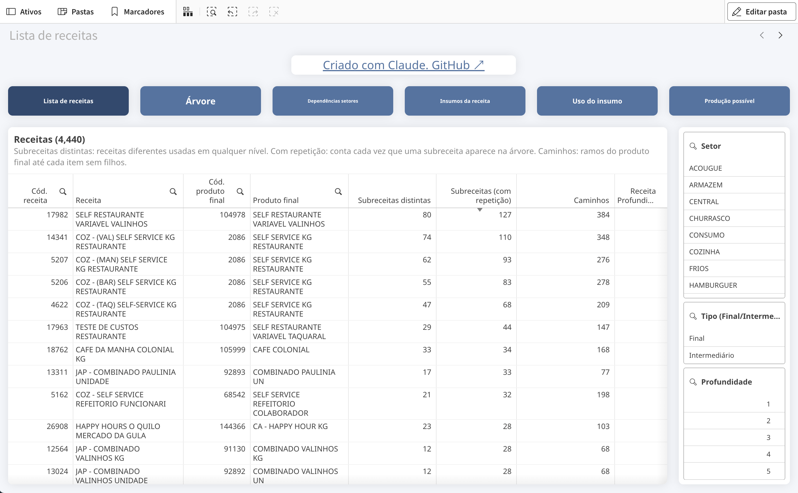

# Receitas e Rendimentos · Qlik Cloud + Consinco

App do Qlik Cloud para o ERP **Consinco**. A partir do módulo **Receitas e Rendimentos**, mostra como as receitas dependem umas das outras e quanto de cada insumo elas consomem.

Criado com Claude.

<p align="center">
  
</p>

<p align="center">
  
  
</p>

## O que o app responde

- Do que uma receita é feita, nível por nível, até os insumos básicos.
- Quanto de cada insumo folha é preciso para produzir um produto ou uma receita inteira.
- Quais receitas usam um insumo, e quanto.
- Quanto produto final dá para fazer com uma quantidade de matéria-prima.
- Quais setores dependem de quais, em qualquer nível da árvore.

## Pastas

| Pasta | Para que serve |
|---|---|
| **Lista de receitas** | Todas as receitas com código, produto final, subreceitas (distintas e com repetição) e número de caminhos |
| **Árvore** | Organograma da receita, com expandir e retrair. Mostra o setor, quanto usa e quanto produz em cada nó. Nós sem filhos ficam em verde claro |
| **Dependências setores** | Fluxo (Sankey) setor fornecedor → setor consumidor e a lista das receitas ligadas, em qualquer nível, no mesmo setor ou entre setores |
| **Insumos da receita** | Produto final da receita e os insumos folha necessários, por unidade, por receita e para N unidades |
| **Uso do insumo** | Receitas que usam um insumo e quanto usam |
| **Produção possível** | Dada uma quantidade de matéria-prima, quanto de cada produto final pode ser feito |

As pastas de receita e de insumo têm caixas para **digitar o código** (receita, produto final ou insumo) e um botão **Filtrar**.

## Arquivos

| Arquivo | Conteúdo |
|---|---|
| `receitas-rendimentos.qvs` | Script de carga completo, copiado do app (seções Main e Modelo) |
| `receitas-rendimentos.qvf` | App exportado do Qlik Cloud, sem dados (pastas, objetos, variáveis e script) |
| `CONTEXTO.md` | Documentação técnica: modelo de dados, regras de cálculo, expressões, decisões e pendências |

## Requisitos

- **Qlik Cloud**, com permissão para criar apps e conexões no espaço.
- **Visualization bundle** habilitado no tenant. O organograma (pasta Árvore) e o Sankey (pasta Dependências setores) vêm desse pacote nativo da Qlik; sem ele, as duas visões aparecem como "visualização inválida". Não há extensões de terceiros.
- **Conexão Oracle** com leitura das tabelas do Consinco listadas em [Fontes no Consinco](#fontes-no-consinco).
- **Volume de referência:** com cerca de 4,4 mil receitas ativas, a carga gera aproximadamente 39 mil nós de árvore e 26 mil linhas de lista de materiais. Ela leva menos de um minuto, porque a explosão recursiva das receitas roda no próprio Oracle.

## Como usar no seu ambiente

### 1. Conexão com o banco do Consinco

O app precisa de uma conexão **Oracle** com acesso de leitura às tabelas do schema `CONSINCO` (ver [Fontes no Consinco](#fontes-no-consinco)). Se ainda não existir uma, crie-a no Qlik Cloud em **Adicionar dados → Oracle**, ou use o Data Gateway se o banco não estiver exposto à internet.

O script veio do ambiente original, que usa a conexão `ETL:Marketway_Consinco`. Troque esse nome pelo da sua conexão na seção **Modelo** do script, na linha:

```
LIB CONNECT TO 'ETL:Marketway_Consinco';
```

Por exemplo, para uma conexão chamada `Consinco_Oracle` no espaço `Dados`:

```
LIB CONNECT TO 'Dados:Consinco_Oracle';
```

O formato é `'<espaço>:<nome da conexão>'`. Para uma conexão no seu espaço pessoal, use só `'<nome da conexão>'`. O jeito mais seguro de acertar o nome é abrir o painel **Conexões de dados** do editor de carga e clicar em **Inserir script de conexão**.

O usuário da conexão precisa de **permissão de leitura** nas tabelas do schema `CONSINCO`. As consultas usam sempre `consinco.<tabela>`; se o seu schema tiver outro nome, troque `consinco.` por ele em todo o script.

### 2. Importar o app

1. No Qlik Cloud, importe o `receitas-rendimentos.qvf` num espaço.
2. Abra o **Editor de carga de dados** e faça a troca da conexão descrita acima.
3. Clique em **Carregar dados**.

### Sem o `.qvf`

Crie um app vazio, cole o conteúdo do `receitas-rendimentos.qvs` no editor de carga, faça a troca da conexão e carregue. Nesse caso, as pastas precisam ser recriadas; a descrição de cada uma está no `CONTEXTO.md`.

## Como manter este repositório

O script de carga existe em dois lugares: no `receitas-rendimentos.qvs` e dentro do `receitas-rendimentos.qvf`. Para não ficarem diferentes, a cada mudança no app:

1. Exporte o app do Qlik Cloud **sem dados** e substitua o `receitas-rendimentos.qvf`.
2. Copie o script inteiro do editor de carga para o `receitas-rendimentos.qvs`, incluindo as seções Main e Modelo.
3. Se a mudança afetar o modelo, as regras ou as pastas, atualize o `CONTEXTO.md`.
4. Faça o commit dos arquivos juntos, com uma mensagem que descreva a mudança no app.

## Fontes no Consinco

`MRL_RECEITARENDTO`, `MRL_RRPRODUTOFINAL`, `MRL_RRCOMPONENTE`, `MRL_SETORPROD` e `MAP_PRODUTO`, todas com registros ativos.
